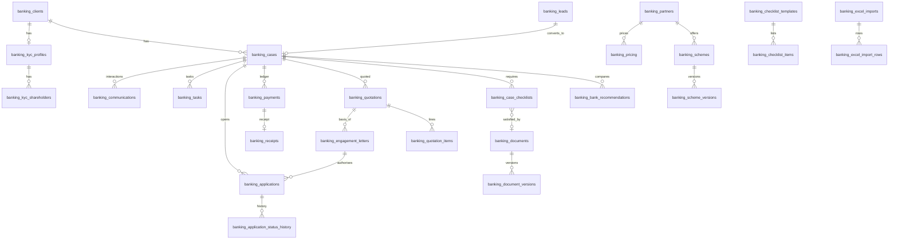

# Banking Base

Database for the `Banking Module`. Tables are `public.banking_*` in the CRM Supabase project, with private file storage in bucket `banking-documents`. This folder holds what defines and tests them.

| Path | Purpose |
|---|---|
| `migrations/001_banking_schema.sql` | Tables, audit triggers, append-only rules, row-level security |
| `private/002_banking_seed.sql` | Roles, settings, banks, document types, checklists, risk rules, schemes from the deck. **Git-ignored and on this PC only**: the repository is public and this holds the company's bank details and internal notes. Back it up separately |
| `migrations/003_banking_workflow.sql` | Workflow functions, gates, quotes, ledger, import, dashboard, reports |
| `migrations/004_banking_storage.sql` | Private bucket and policies (skipped on plain Postgres) |
| `migrations/005_banking_18_steps.sql` | Moves cases to the 18-step workflow |
| `migrations/006_banking_document_numbers.sql` | Document number format and serial counters; record of each generated file with its number, serial and location |
| `migrations/007_banking_receipt_documents.sql` | Saved fee receipt vouchers join the generated files record |
| `migrations/008_banking_task_client.sql` | Lets a task belong to a client with no case |
| `migrations/009_banking_lead_pipeline.sql` | Lead pick-up, and Converted meaning bank selected and payment received |
| `migrations/010_banking_official_names.sql` | Official bank names and websites; old names kept as aliases |
| `migrations/011_banking_handover_accounts.sql` | Reassign with acceptance; case lock and access rules while with Accounts (Accounts side: `Accounting Base`). Re-running 001 resets policies, so run 011 again after it |
| `migrations/012_banking_legacy_crm.sql` | Import from the old CRM's Banking Sheet: separate signing and opening dates on applications, staging keyed by old task id, matching against the draft. Staging changes only import tables |
| `migrations/013_banking_banque_misr.sql` | Adds Banque Misr to the bank master, with no plans or pricing yet |
| `migrations/015_banking_simple_bank_process.sql` | Simple bank timeline and `banking_client_accounts`. Stages stay 1-18 in the data; screens show 14-17 as Bank Follow-up and 18 as Completion. Re-running 001 resets the audit mask, so run 015 again after it. Undo: `rollback/015_rollback.sql` |
| `migrations/014_banking_board_status.sql` | Old CRM board status becomes the target: stored on the case, and it decides the application status |
| `migrations/016_banking_board_counts.sql` | Adds board status and dashboard counts to the case list |
| `scripts/legacy_crm_load.py` | Turns the old CRM CSV export into the staging SQL. Connects to nothing. Keep its output in `data/` |
| `scripts/legacy_release_bank.sql` | Releases old CRM rows held only for an unknown bank, after that bank is added |
| `tests/run-local.sh` | Runs everything on a throwaway Postgres. Never touches Supabase |
| `data/` | Local extracts, if any. Git-ignored |

## Deployment

**Status: applied 31/10/2026 to `pnnakrhfzyxudjaghoxx`. Code not yet merged to `main`.** All migrations re-run safely.

1. Back up, then apply `migrations/001`, `private/002`, `migrations/003`, `migrations/004`, `migrations/005`, `migrations/006`, `migrations/007`, `migrations/008`, `migrations/009`, `migrations/010`, `migrations/011`, then `Accounting Base/migrations/001` in that order to Supabase project `pnnakrhfzyxudjaghoxx`, using the same `supabase db query` route as `Email Base/deploy_to_crm.sh`.
2. In the CRM: Settings > Users & Permissions, assign banking roles. CRM admins already have access.
3. Check by hand: create a lead, convert it, select a bank, upload a file, issue and accept a quotation, record a payment, generate and sign a letter, open an application, then run one small Excel import.
4. Merge the code to `main`. The GitHub Pages workflow deploys it. Merge after step 1, otherwise users see a setup message in the tab.

Rollback: nothing outside `banking_*`, the bucket and two policies on `storage.objects` is touched. Drop those to remove the module. Code rollback is a revert of the merge.

## Importing from the old CRM

The old CRM's Banking Working Sheet export has two folders, with fields in `custom_fields`. Manager is the contact, Client Name the referrer, RM KB or RM FEES the commission, and Net is not stored. Most Monthly Bank Account rows repeat a Banking Sheet row, so the loader merges rows with the same company and bank in the same date or month. Monthly `OPENING DATE` is read as the signing date. Between the folders, a final result outranks work in progress; Approved against Rejected, or two different fees, is held. Against the draft, the old CRM wins on status, fee and RM fee (the user's decision, 02/11/2026) and fills other blanks. A committed case changed in the CRM since its import is not overwritten.

| `reconcile_result` | Meaning | When applied |
|---|---|---|
| `Matches Committed` | The draft already has this case | Row linked to the case. Status, fee and RM fee take the old CRM's value, with the change in the status history and `conflicts`. Blank contact, nationality and RM filled; signing and opening dates stored |
| `Matches Draft` | The draft row was still waiting | Old CRM row commits, with draft-only values carried over. Draft row and its repeats become `Skipped` with `duplicate_of` set |
| `New` | Not in the draft | Row commits |
| `Conflict` | The draft row was skipped, the bank is not in the bank list, the loader held it, or the case changed since its import | Row becomes `Skipped` with the differences in `conflicts`. Nothing changes until a person decides |
| `No Status` | Neither source gives a status | Row stays `Pending` |

Payment notes go to the review queue as usual. No payment is posted.

1. Back up, apply `migrations/012`, then run `scripts/legacy_crm_load.py` with an admin's `profiles.id` and run its output. This only stages and matches.
2. Read the result: `select reconcile_result, count(*) from banking_excel_import_rows where legacy_task_id is not null group by 1`.
3. To apply, in one transaction: `select set_config('request.jwt.claim.sub', '<admin id>', true); select banking_legacy_apply('<import id>');`.

**Status: applied to `pnnakrhfzyxudjaghoxx` on 02/11/2026.** 983 deals from 1,482 tasks, then synced to the old CRM board status (014). Of the 880 Banking Sheet rows, 865 have a case and 15 are held.

A fuller export can be loaded the same way: rows already committed stay as they are. Rollback before step 3: delete the import's rows and its `banking_excel_imports` row. After step 3 restore from the backup, since history tables are append-only.

## Data model

## Rules enforced by the database

- Workflow tables are read-only through the API; changes go through functions that check permissions.
- Payments, receipts, status and stage history, document and scheme versions, and the activity log cannot be updated or deleted, even by the table owner, without dropping the trigger.
- Only one selected bank, one active application and one accepted quotation per case.
- Passport, Emirates ID, address and transaction reference values are masked in the activity log.
- `banking_kyc_shareholders` needs `kyc.sensitive`; `banking_commissions` (Excel "RM FEES") needs `reports.finance`.
