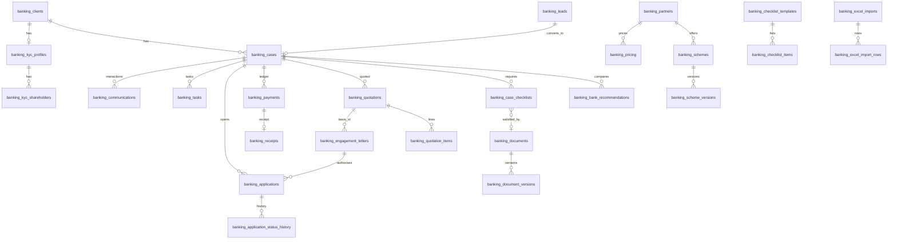

# Banking Base

Database for the `Banking Module`. Tables are `public.banking_*` in the CRM Supabase project, with private file storage in bucket `banking-documents`. This folder holds what defines and tests them.

| Path | Purpose |
|---|---|
| `migrations/001_banking_schema.sql` | Tables, audit triggers, append-only rules, row-level security |
| `private/002_banking_seed.sql` | Roles, settings, banks, document types, checklists, risk rules, schemes from the deck. **Git-ignored and on this PC only**: the repository is public and this holds the company's bank details and internal notes. Back it up separately |
| `migrations/003_banking_workflow.sql` | Workflow functions, gates, quotes, ledger, import, dashboard, reports |
| `migrations/004_banking_storage.sql` | Private bucket and policies (skipped on plain Postgres) |
| `tests/run-local.sh` | Runs everything on a throwaway Postgres. Never touches Supabase |
| `data/` | Local extracts, if any. Git-ignored |

## Deployment

**Status: not applied to any live database yet.** All migrations re-run safely.

1. Back up, then apply `migrations/001`, `private/002`, `migrations/003`, `migrations/004` in that order to Supabase project `pnnakrhfzyxudjaghoxx`, using the same `supabase db query` route as `Email Base/deploy_to_crm.sh`.
2. In the CRM: Settings > Users & Permissions, assign banking roles. CRM admins already have access.
3. Check by hand: create a lead, convert it, select a bank, upload a file, issue and accept a quotation, record a payment, generate and sign a letter, open an application, then run one small Excel import.
4. Merge the code to `main`. The GitHub Pages workflow deploys it. Merge after step 1, otherwise users see a setup message in the tab.

Rollback: nothing outside `banking_*`, the bucket and two policies on `storage.objects` is touched. Drop those to remove the module. Code rollback is a revert of the merge.

## Data model

## Rules enforced by the database

- Workflow tables are read-only through the API; changes go through functions that check permissions.
- Payments, receipts, status and stage history, document and scheme versions, and the activity log cannot be updated or deleted, even by the table owner, without dropping the trigger.
- Only one selected bank, one active application and one accepted quotation per case.
- Passport, Emirates ID, address and transaction reference values are masked in the activity log.
- `banking_kyc_shareholders` needs `kyc.sensitive`; `banking_commissions` (Excel "RM FEES") needs `reports.finance`.
