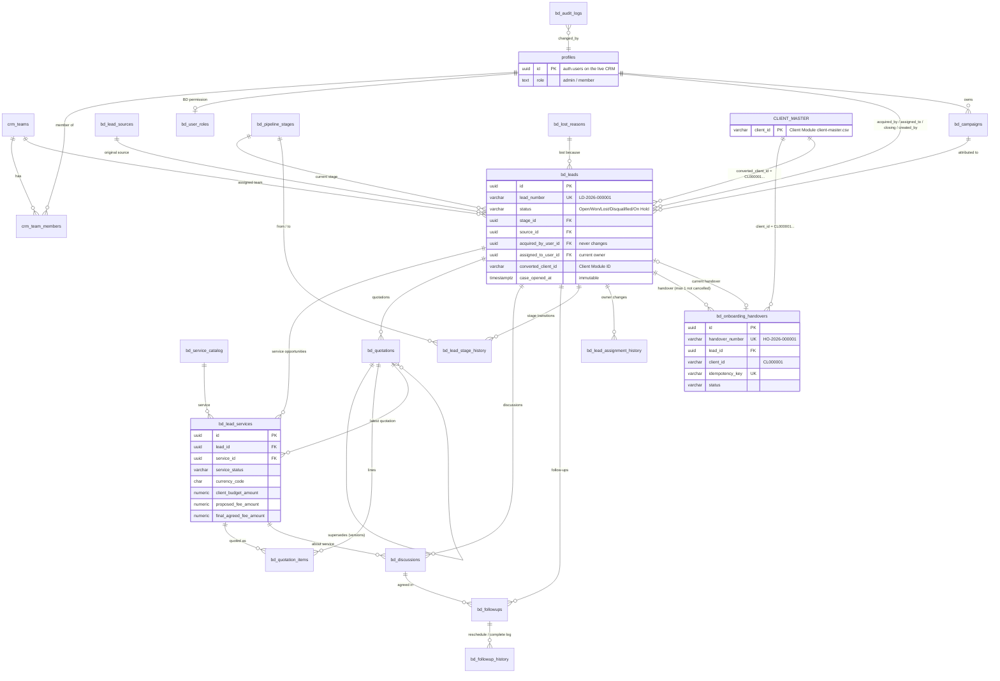

# BD backend: entity-relationship diagram

This diagram matches `migrations/bd/001_bd_schema.sql` (draft). Only the key columns are shown; the full column list is in `SQL Data/BD_Field_Mapping.xlsx`.

Key for the boxes:
- **Grey**, reused from the CRM: `profiles`, plus the Client Master. The Client Master is outside this database; it lives in the Client Module as `client-master.csv`.
- **New shared CRM tables**: `crm_teams`, `crm_team_members`.
- **Everything else** is new in the BD part.

## Notes

- **Users:** the live CRM's `public.profiles` (`id = auth.uid()`) is the user table. The migration creates `profiles` only when it is missing, which is the case in a local database.
- **Client Master link:** the Client Master is the Client Module CSV, so `converted_client_id` and `bd_onboarding_handovers.client_id` cannot be database foreign keys:
  - they are `VARCHAR(20)` values checked against the `CL000001` format;
  - the API checks each one against the Client Module (`GET /api/clients/{id}`) before saving it.
  - When the Client Master moves into this database, these become real foreign keys.
- **Quotation templates:** `bd_quotations.quotation_template_id` will point to the live `public.quotation_templates` (the freezone .docx templates). The foreign key will be added when the BD part is deployed to the CRM's Supabase project.
- **Append-only tables:** stage history, assignment history, follow-up history and audit logs. A trigger rejects UPDATE and DELETE on them.
